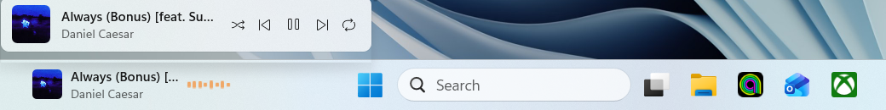

# Flyout Taskbar

Now playing, inside the Windows 11 taskbar.

Album artwork, the track, the artist and an animation that runs only while
something is actually playing. Clicking the strip opens a player popover with
previous / play-pause / next, shuffle and repeat.

It reads the Windows System Media Transport Controls, so it follows Spotify, a
YouTube tab in a browser, or anything else that publishes a media session — no
per-app setup.

The strip is a real child of the taskbar's own XAML tree, not a window floating
over it. Windows 11 removed deskbands and offers no supported API for putting
content in the taskbar, so a [Windhawk](https://windhawk.net/) mod is the only
way to be genuinely *inside* it.

## How this compares to the other media mods

Windhawk's catalog already has **Taskbar Fluent Media Player**, **Island Media
Controls** and **Taskbar Music Lounge**, and the first two also inject into the
taskbar's XAML tree. So "really inside the taskbar" is not the differentiator.

The difference is scope. This mod is deliberately small: one hooked symbol, one
fixed layout, four settings. Taskbar Fluent Media Player is the full-featured
option — 20+ placements, auto-hide, theme-aware materials — and if you want
those, use it instead. Pick this one if you want a minimal strip with a
cross-fade between tracks and a decorative playing indicator, and nothing else
to configure.

## Install

1. Install [Windhawk](https://windhawk.net/) — a normal Windows installer, once.
2. Open Windhawk and go to **Explore**.
3. Search for **Fluent Music in the taskbar** and press **Install**.

Windhawk compiles the mod locally and keeps it updated. Uninstalling is one
click and leaves the taskbar exactly as it was.

Until the mod is listed, install it by hand instead: in Windhawk choose
*Create a new mod*, paste
[`windhawk/fluent-music-taskbar.wh.cpp`](windhawk/fluent-music-taskbar.wh.cpp)
over the template, and press **Compile**.

## Settings

In Windhawk, under the mod's **Settings** tab:

* **Distance from the left** moves the strip along the taskbar. The strip is
  drawn *over* the taskbar rather than reserving space in it, so it needs a clear
  run: anything underneath it cannot be clicked. The default sits it in the empty
  gap between the widgets button and the centred Start icons. With a left-aligned
  taskbar, or with many windows open and a centred taskbar, the task buttons can
  grow under it — move the strip if that happens.
* Album artwork and the popover controls can each be turned off.
* **Playing animation** is a decorative indicator, not an audio visualizer — it
  is not driven by the audio signal, it only tells you something is playing.

## Compatibility

Developed and tested on Windows 11 25H2 (build 26200). It hooks
`TaskbarFrame::OnTaskbarLayoutChildBoundsChanged` in `Taskbar.View.dll`; if that
symbol is absent on your build, the mod logs a failure and does nothing rather
than misbehaving.

Secondary monitors each get their own strip, and all of them update together.

MIT licensed.

## `tools/SmtcProbe/`

A small console probe that dumps whatever the media session currently reports —
title, artist, playback state, thumbnail bytes. Useful for telling "the app
isn't publishing artwork" apart from "our code isn't showing it".
